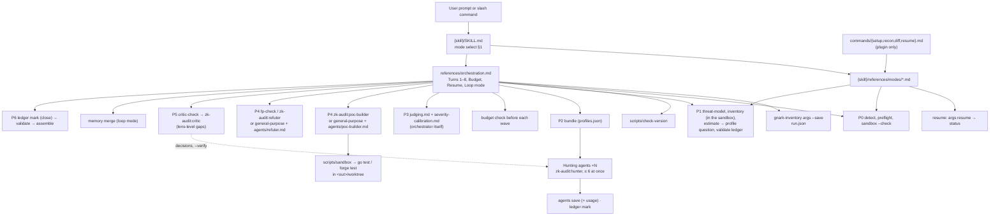
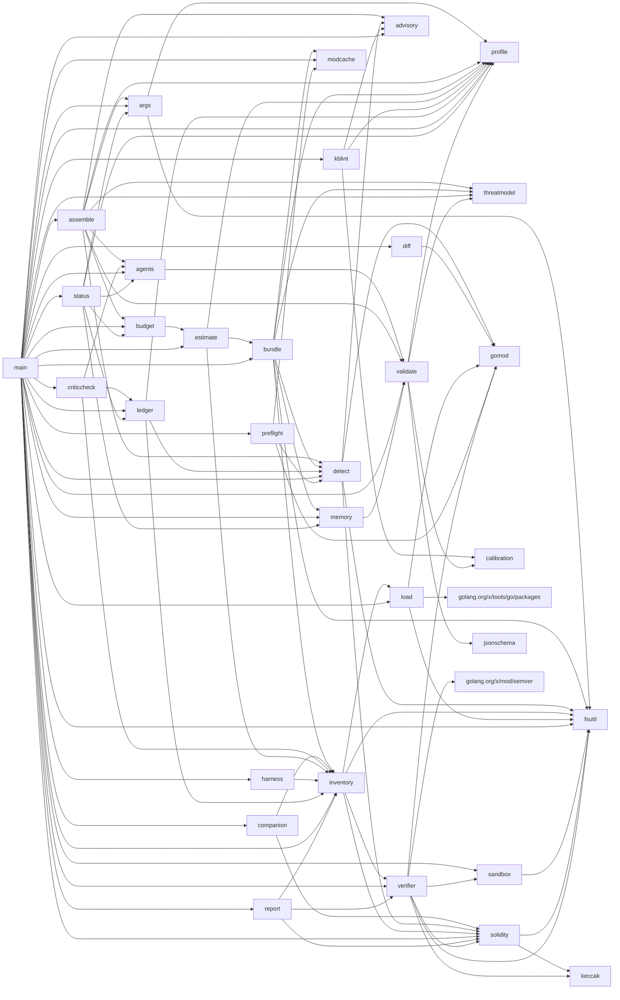

# Call Graph

> skill / commands → orchestrator → agents and scripts → `gnark-inventory` subcommands → Go packages → files

Prompt-level edges (top half) are instructions in Markdown; the model follows
them, nothing enforces the order. Go-level edges (bottom half) are derived from
the code: `go list -f '{{.ImportPath}}|{{join .Imports ","}}' ./...` and
`go list -deps` run in `{skill}/tools/gnark-inventory` with
`GOFLAGS=-mod=vendor`, and the call sites in `main.go`.

`{skill}` = `plugins/zk-audit/skills/zk-audit`. Refreshed 2026-10-29 for the
tree after shramee/zk-audit#16; the snapshot of `4d9cf86` is in git history.

---

## 1. Prompt level



### Which reference each phase loads

| Phase / turn | Runs | Loads (SKILL.md §8) | Produces |
|---|---|---|---|
| Turn 1, P0 | `gnark-inventory args --save`, `detect`, `preflight`, `sandbox --check`; `check-version`; companion detection | `companions.md`, `gnark-versions.md` | `<out>/run.json`, `stack.json`, banner, stack line, phase table |
| Turn 2, P1 | `threat-model`, `inventory`, `estimate` (then the profile question), `validate ledger`, verifier provenance (`verifier regen` in deep); orchestrator reads `inventory.md` and every `Define` | — | `threat-model.json`, `inventory.json`, `inventory.md`, `binding-table.md` (completed by the model), `system-map.md`, `coverage-ledger.json`, `estimate.json` |
| Turn 3 | `gnark-inventory bundle --skill {skill} --profile P` | the tool inlines `senior-auditor-sop.md`, `agents/<lens>.md`, `attack-vectors/<slice>.md`, `shared-rules.md`, the threat model and the loop memory | `bundles/<ID>.md`, `bundles/index.json` |
| Turn 4, P2 | `budget check`; hunting agents; `solidity-auditor` on the worktree and `convert pashov` (standard, deep, when installed) | their bundle | `agents/<ID>.md` and `agents/index.json` via `agents save`, `spend.json`, ledger units via `ledger mark` |
| Turn 5, P3 | orchestrator | `judging.md`, `severity-calibration.md`, `rationalizations.md` | draft `findings.json`; candidate units closed |
| Turn 6, P4 | `budget check`; `git worktree add`; poc-builder through `scripts/sandbox`; refuter | `poc-templates.md`, `judging.md` §6 | `pocs/*`, `evidence` / `poc` / `refuter` fields; `budget record` per agent |
| Turn 7, P5 | `critic-check`; coverage critic; `budget check`; targeted wave; `critic-check --verify` | — | `critic-check.json`, a ledger decision per missing unit |
| Loop mode | `memory init`, a pass = Turns 3–7, `memory merge` | — | `memory.json`, `passes/<p>/findings.json`, cumulative `findings.json` |
| Turn 8, P6 | `ledger mark` (close), `validate findings`, `validate ledger`, `assemble` | `report-format.md` | `REPORT.md`, `pocs/MANIFEST.json` |
| recon mode | P0 + P1 | `modes/recon.md` | printed tables; `zk-audit.md` from the template on yes |
| diff mode | `gnark-inventory diff`, then the standard profile on the change | `modes/diff.md` | `diff.json`, `diff.md`, as a full audit |
| resume mode | `args --save -- resume`, `status`, then the first incomplete turn | `modes/resume.md` | continues `<out>` |
| library mode | full audit with the `library` profile, `harness` for PoCs | `modes/library.md` | as a full audit, gadget-contract table |
| setup mode | detection commands, `gnark-inventory version`, `check-version` | `modes/setup.md`, `companions.md` | status table |

### Companion calls (prompt level)

| Companion | Called from | Fallback |
|---|---|---|
| `circom-auditor` | P0 routing (`SKILL.md` Phase 0, `detect` route string) | `attack-vectors/generic-zk.md` |
| `fp-check` | P4 refuter (`orchestration.md` Turn 6 step 3) | `zk-audit:refuter` / brief |
| `solidity-auditor` | Turn 4, on the scratch worktree; output through `gnark-inventory convert pashov` | S1 + V-contract |
| `spec-to-code-compliance` | C6 lens (`references/agents/C6-spec-invariant.md`) | C6 itself |
| `supply-chain-risk-auditor` | I4 lens (`references/agents/I4-prover-service.md`) | `gnark-versions.md` |
| `differential-review` | diff mode | the standard profile on the change |
| `x-ray`, `audit-context-building`, `vulnerability-triage-brocards`, `variant-analysis`, `static-analysis`, `building-secure-contracts`, `property-based-testing`, `mutation-testing`, zkao | listed in `SKILL.md` §5 / `companions.md` only; no turn names a call site | see `companions.md` |

---

## 2. Scripts → subcommands → Go entry points

| Script call (from) | Subcommand | `main` function | Package calls |
|---|---|---|---|
| Turn 1, resume | `args` | `cmdArgs` | `args.Split`, `args.Parse`, `args.Save` (`--save`), `args.Load` (resume) |
| P0 | `detect` | `cmdDetect` | `detect.Detect` |
| P0 | `preflight` | `cmdPreflight` | `preflight.Check` with `modcache`, `gomod` |
| P0, Turn 4, P4 | `sandbox` (`scripts/sandbox`) | `cmdSandbox` | `sandbox.Detect`, `sandbox.Run` (bubblewrap, `sandbox-exec`, or limits only) → `sandbox.Stage2` re-exec |
| P1 | `threat-model` | `cmdThreatModel` | `threatmodel.Load` → `validate.Document("threat-model")` |
| P1, recon, diff | `inventory` | `cmdInventory` | re-runs itself in the sandbox → `load.Load` → `inventory.Build` → `detect.Detect` → `verifier` provenance (ABI, ceremony) → `ledger.Seed` → `report.Inventory`, `report.BindingTable` |
| P1 | `estimate` | `cmdEstimate` | `estimate.Profiles` → `bundle.Shards`, `bundle.Plan`, `bundle.SourceLines` |
| Turn 3 | `bundle` | `cmdBundle` | `bundle.Build` (`Plan`, `threatSection`, `memory.Load`, `modcache`) |
| Turn 4, 7 | `agents save\|list` | `cmdAgents` | `agents.SaveWith`; `budget.Record` (spend) |
| Turns 4–8 | `ledger mark\|add\|show` | `cmdLedger` | `ledger.Load`, `Mark`, `Add`, validated with `validate.DocumentWith(--out)` before `WriteAtomic` |
| before each wave, P4 | `budget record\|check\|show` | `cmdBudget` | `budget.Load`, `Record`, `Check`, `ApplyBudget` |
| resume | `status` | `cmdStatus` | `status.Read` (`args`, `agents`, `ledger`, `memory`, `budget`) |
| Turn 7 | `critic-check [--verify]` | `cmdCriticCheck` | `criticcheck.Check`, `criticcheck.Undecided` |
| loop mode | `memory init\|merge\|known\|status` | `cmdMemory` | `memory.Init`, `Merge`, `Known`, `Status` |
| diff mode | `diff` | `cmdDiff` | `diff.Compare` (git objects only) |
| Turn 2 (deep), user artifacts | `verifier abi\|diff\|vk\|bytecode\|regen\|ceremony` | `cmdVerifier` | `verifier.*` (`regen` runs gnark in the sandbox) |
| Turn 4 | `convert pashov` | `cmdConvert` | `companion.ConvertPashov` |
| library PoCs | `harness` | `cmdHarness` | `harness.Generate` |
| P1, P6, `scripts/validate-*` | `validate findings\|ledger\|stack\|threat-model` | `cmdValidate` | `validate.DocumentWith` |
| P6, `scripts/assemble` | `assemble` | `cmdAssemble` | `assemble.Assemble` (reads `run.json`, `spend.json`, `agents/index.json`, `bundles/index.json`, `threat-model.json` from `--out`) |
| `make sync-profiles`, tests | `profiles` | `cmdProfiles` | `profile.Load`, `ProfileTable`, `AgentTable`, `SyncDocs` |
| `make lint-kb`, CI | `lint-kb` | `cmdLint` | `kblint.Lint` (vectors, advisories, calibration) |
| P0, `--osv` on consent | `advisories` | `cmdAdvisories` | `advisory.Load`; `advisory.NewOSV` diff with `--osv` |
| (manual) | `rules`, `version` | `run` | `inventory.Rules`, constant `Version` |

### Inside the packages (main paths)

```text
args.Parse            words → Run (mode, profile, scope, flags, --budget, out, run_id); resume → Load(<out>/run.json)
load.Load             go/packages typed load (targetEnv: CGO_ENABLED=0, GOWORK=off, GOFLAGS=, GOPROXY=off,
                      GOTOOLCHAIN=local offline) with a go/parser fallback; inventory re-execs inside the sandbox
inventory.Build       circuits + witness walk, hint taint (findSites → propagate → sinks), 23 footgun rules,
                      exported gadgets (library mode), solidity scan (inheritance, imports, privileged, entry points)
ledger.Seed           one unit per profiles.json seed subject and class (circuit, contract-fn, privileged, entry,
                      gadget, custom-verifier), plus hints, public inputs, verifiers, prover files, dependencies
bundle.Plan / Build   lenses of the profile × shards (when-conditions, empty shards) → bundles/<ID>.md
estimate.Profiles     Plan × calibrated tokens per role → agents, tokens, USD and minutes as ranges
budget.Check          spend so far (reported or role-average tokens) + next wave at the high rate vs the ceiling
criticcheck.Check     open units, units with no saved output, inventory items no output cites or names
status.Read           files in <out> → steps, agents saved / missing / retry / blocked, next step
validate.DocumentWith schema + semantics (PoC files, agent outputs, trust rules, calibration anchors, accepted
                      risks against threat-model.json)
assemble.Assemble     validate ×3 → checkClaims → crossCheck → render (quotes via EvalSymlinks inside the repo,
                      coverage = covered only, threat model, spend, not-covered lines) → MANIFEST.json
sandbox.Run           bwrap: own net and pid namespaces, read-only root, --rw dirs only, $HOME masked, RLIMIT_AS,
                      wall-clock kill of the process group (exit 124)
```

---

## 3. Go package dependency graph

Internal edges (from `go list` imports, `GOFLAGS=-mod=vendor`; `main` = the
tool's `package main`):



| Package | Non-blank, non-comment Go lines | Imports (internal) | Tests |
|---|---:|---|---|
| `internal/inventory` | 2985 | `fsutil`, `load`, `solidity`, `verifier` | `gadgets_test.go`, `inventory_test.go` |
| `internal/solidity` | 2321 | `fsutil`, `keccak` | `privileged_test.go`, `repo_test.go`, `scan_test.go` |
| `main` | 2021 | `advisory`, `agents`, `args`, `assemble`, `budget`, `bundle`, `companion`, `criticcheck`, `detect`, `diff`, `estimate`, `fsutil`, `harness`, `inventory`, `kblint`, `ledger`, `load`, `memory`, `modcache`, `preflight`, `profile`, `report`, `sandbox`, `solidity`, `status`, `threatmodel`, `validate`, `verifier` | `advisories_test.go`, `cmd_harness_test.go`, `cmd_product_test.go`, `cmd_test.go`, `docs_test.go`, `main_test.go` |
| `internal/verifier` | 1738 | `fsutil`, `gomod`, `keccak`, `sandbox`, `solidity` | `abi_test.go`, `provenance_test.go`, `regen_test.go` |
| `internal/assemble` | 1647 | `advisory`, `agents`, `args`, `budget`, `detect`, `profile`, `threatmodel`, `validate` | `assemble_test.go` |
| `internal/report` | 701 | `inventory`, `solidity`, `verifier` | via callers |
| `internal/bundle` | 635 | `detect`, `fsutil`, `inventory`, `memory`, `modcache`, `profile`, `threatmodel` | `bundle_test.go` |
| `internal/diff` | 579 | `gomod` | `diff_test.go` |
| `internal/advisory` | 566 | — | `advisory_test.go` |
| `internal/detect` | 531 | `advisory`, `fsutil`, `gomod`, `solidity` | `detect_test.go` |
| `internal/jsonschema` | 523 | — | `jsonschema_test.go` |
| `internal/validate` | 517 | `calibration`, `jsonschema`, `profile`, `threatmodel` | `validate_test.go` |
| `internal/sandbox` | 514 | `fsutil` | `sandbox_test.go` |
| `internal/args` | 485 | `fsutil`, `profile` | `args_test.go` |
| `internal/ledger` | 482 | `detect`, `inventory`, `profile` | `seed_test.go` |
| `internal/threatmodel` | 449 | — | `threatmodel_test.go` |
| `internal/profile` | 441 | — | `profile_test.go` |
| `internal/companion` | 437 | `inventory`, `solidity` | `pashov_test.go` |
| `internal/kblint` | 411 | `advisory`, `calibration`, `profile` | `kblint_test.go` |
| `internal/harness` | 358 | `inventory` | `harness_test.go` |
| `internal/status` | 341 | `agents`, `args`, `budget`, `ledger`, `memory`, `profile` | `status_test.go` |
| `internal/estimate` | 333 | `bundle`, `inventory`, `profile` | `estimate_test.go` |
| `internal/memory` | 321 | `validate` | `memory_test.go` |
| `internal/criticcheck` | 297 | `agents`, `inventory`, `ledger` | `criticcheck_test.go` |
| `internal/budget` | 261 | `estimate` | `budget_test.go` |
| `internal/load` | 255 | `fsutil`, `gomod` | `load_test.go` |
| `internal/preflight` | 231 | `detect`, `gomod`, `modcache` | `preflight_test.go` |
| `internal/modcache` | 176 | — | `modcache_test.go` |
| `internal/gomod` | 144 | — | `gomod_test.go` |
| `internal/calibration` | 133 | — | `calibration_test.go` |
| `internal/fsutil` | 117 | — | `inside_test.go` |
| `internal/agents` | 102 | `validate` | via callers |
| `internal/keccak` | 72 | — | `keccak_test.go` |
| `internal/fixture` | 34 | — | via callers |
| **total** | **21158** | | 167 `Test*` functions in 41 files |

External modules (`vendor/modules.txt`): `golang.org/x/tools v0.30.0`
(`go/packages` and its internal deps, through `internal/load`),
`golang.org/x/mod v0.23.0` (`semver`, through `internal/verifier` and
`go/packages`), `golang.org/x/sync v0.11.0` (`errgroup`, inside
`go/packages`). The rest is the standard library.

---

## 4. Files touched per component

| Component | Reads | Writes |
|---|---|---|
| `scripts/gnark-inventory` | `tools/gnark-inventory` sources (hashed), `main.go` `Version`; `ZK_AUDIT_GO` | `$ZK_AUDIT_BIN/gnark-inventory-<ver>-<hash>[-<go>]` |
| `scripts/check-version` | `{skill}/VERSION`, the published `VERSION` URL | stdout only |
| `scripts/sandbox` | the command's `--ro` / `--rw` dirs, the module cache, Go root (read-only) | only the `--rw` dirs and `~/.zk-audit/gocache` |
| `args --save` | `<repo>` (scope paths), `<out>/run.json` on resume | `<out>/run.json` |
| `detect`, `preflight`, `inventory` | `<repo>` (read-only; type loading runs `go list` in the sandbox), the module cache | `<out>` files listed in `entry-points.md` |
| `threat-model` | `<repo>/zk-audit.md` | `<out>/threat-model.json` |
| `estimate` | `<out>/inventory.json`, `<repo>` sources (line counts) | `<out>/estimate.json` |
| `bundle` | `<out>/inventory.json`, `binding-table.md`, `threat-model.json`, `memory.json`, `regen/diff.json`, `{skill}/references/**`, `<repo>` sources (line counts, imports), the module cache (std paths) | `<out>/bundles/` |
| `agents`, `ledger`, `budget`, `memory` | `<out>` | `<out>/agents/`, `coverage-ledger.json`, `spend.json`, `memory.json`, `passes/`, `findings.json` (memory merge) |
| `status`, `critic-check` | `<out>` | `critic-check.json` (critic-check only) |
| `verifier regen` | `<repo>` (read-only), the module cache | `<out>/regen/` (gnark runs in the sandbox) |
| `validate` | the given file; with `--out`, `<out>/pocs/`, `<out>/agents/`, `threat-model.json` | — |
| `assemble` | `<out>/{findings,coverage-ledger,stack,inventory,threat-model,spend,run}.json`, `agents/index.json`, `bundles/index.json`, `<repo>` files named by locations | `<out>/REPORT.md`, `<out>/pocs/MANIFEST.json`; `<repo>/zk-audit-report-<run-id>.md` with `--file-output` only |
| `lint-kb` | `{skill}/SKILL.md`, `{skill}/references/**`, optional gnark checkout | — |
| orchestrator (model) | everything above, `<repo>` | `<out>/binding-table.md` (completion), `system-map.md`, `raw/<ID>.md`, `findings.json`, `passes/<p>/findings.json`; `<repo>/zk-audit.md` (recon, on yes) |
| poc-builder | finding, templates, worktree sources | `<out>/pocs/`, `<out>/worktree/<pkg>/` (and the worktree's `go.mod` / `go.sum` via `-mod=mod`) |
