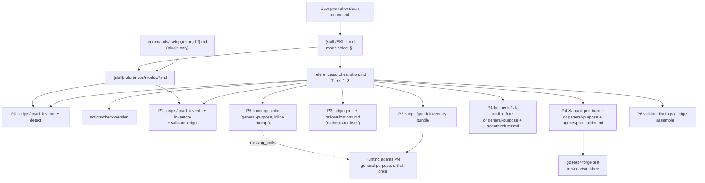
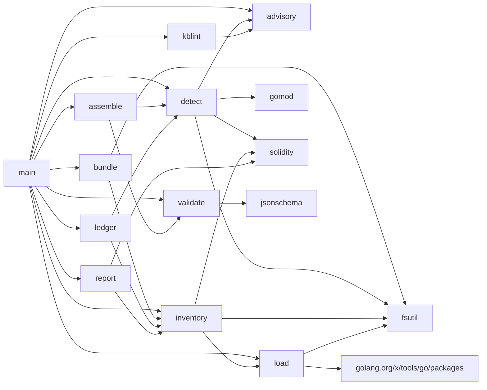

# Call Graph

> skill / commands → orchestrator → agents and scripts → `gnark-inventory` subcommands → Go packages → files

Prompt-level edges (top half) are instructions in Markdown; the model follows
them, nothing enforces the order. Go-level edges (bottom half) are derived from
the code: `go list -f '{{.ImportPath}}|{{join .Imports ","}}' ./...` and
`go list -deps` run in `{skill}/tools/gnark-inventory` with
`GOFLAGS=-mod=vendor`, and the call sites in `main.go`.

`{skill}` = `plugins/zk-audit/skills/zk-audit`.

---

## 1. Prompt level



### Which reference each phase loads

| Phase / turn | Runs | Loads (SKILL.md §8) | Produces |
|---|---|---|---|
| Turn 1, P0 | orchestrator; `gnark-inventory detect`; `check-version`; companion detection | `companions.md`, `gnark-versions.md` | `<out>/stack.json`, banner, stack line, phase table |
| Turn 2, P1 | `gnark-inventory inventory`, `validate ledger`; orchestrator reads `inventory.md` and every `Define` | — | `inventory.json`, `inventory.md`, `binding-table.md` (completed by the model), `system-map.md`, `coverage-ledger.json` |
| Turn 3 | `gnark-inventory bundle --skill {skill} --profile P` | the tool inlines `senior-auditor-sop.md`, `agents/<lens>.md`, `attack-vectors/<slice>.md`, `shared-rules.md` | `bundles/<ID>.md`, `bundles/index.json` |
| Turn 4, P2 | hunting agents (prompt in `orchestration.md` Turn 4) | their bundle | raw FINDING / LEAD text → `agents/<ID>.md`; ledger units → `covered` / `candidate` / `blocked` |
| Turn 5, P3 | orchestrator | `judging.md`, `rationalizations.md` | draft `findings.json` |
| Turn 6, P4 | `git worktree add`; poc-builder; refuter | `poc-templates.md`, `judging.md` §6 | `pocs/*`, `evidence` / `poc` / `refuter` fields |
| Turn 7, P5 | coverage critic; targeted wave | — | `missing_units`; ledger `deferred` with reasons |
| Turn 8, P6 | `validate findings`, `validate ledger`, `assemble` | `report-format.md` | `REPORT.md` |
| recon mode | P0 + P1 | `modes/recon.md` | printed tables; `zk-audit.md` on yes |
| diff mode | 2 worktrees, `inventory` ×2, standard profile on the change | `modes/diff.md` | as a full audit |
| setup mode | detection commands, `gnark-inventory version`, `check-version` | `modes/setup.md`, `companions.md` | status table |

### Companion calls (prompt level)

| Companion | Called from | Fallback |
|---|---|---|
| `circom-auditor` | P0 routing (`SKILL.md` Phase 0, `detect` route string `detect.go:266`) | `attack-vectors/generic-zk.md` |
| `fp-check` | P4 refuter (`orchestration.md` Turn 6 step 3) | `zk-audit:refuter` / brief |
| `spec-to-code-compliance` | C6 lens (`references/agents/C6-spec-invariant.md`) | C6 itself |
| `supply-chain-risk-auditor` | I4 lens (`references/agents/I4-prover-service.md`) | `gnark-versions.md` |
| `differential-review` | diff mode step 4 | the standard profile on the change |
| `solidity-auditor`, `x-ray`, `audit-context-building`, `vulnerability-triage-brocards`, `variant-analysis`, `static-analysis`, `building-secure-contracts`, `property-based-testing`, `mutation-testing`, zkao | listed in `SKILL.md` §5 / `companions.md` only; no turn names a call site | see `companions.md` |

---

## 2. Scripts → subcommands → Go entry points

| Script call (from) | Subcommand | `main.go` | Package calls |
|---|---|---|---|
| `scripts/gnark-inventory detect` (P0, diff) | `detect` | `cmdDetect` :131 | `detect.Detect` :142 |
| `scripts/gnark-inventory inventory` (P1, recon, diff) | `inventory` | `cmdInventory` :156 | `load.Load` :185 → `inventory.Build` :189 → `detect.Detect` :193 → `ledger.Seed` :197 → `report.Inventory` :201, `report.BindingTable` :204 |
| `scripts/gnark-inventory bundle` (Turn 3) | `bundle` | `cmdBundle` :256 | `bundle.Build` :272 |
| `scripts/gnark-inventory validate …`, `scripts/validate-findings`, `scripts/validate-ledger` (P1, P6) | `validate` | `cmdValidate` :293 | `validate.Document` :301 |
| `scripts/gnark-inventory assemble`, `scripts/assemble` (P6) | `assemble` | `cmdAssemble` :324 | `assemble.Assemble` :356 |
| `make lint-kb`, CI | `lint-kb` | `cmdLint` :381 | `kblint.Lint` :390 with `inventory.RuleIDs()` |
| (manual) | `advisories` | `cmdAdvisories` :407 | `advisory.Load` :413, `advisory.Raw` :418, `(*Table).Affecting` :421 |
| (manual) | `rules` | `run` :79 | `inventory.Rules` |
| `scripts/gnark-inventory version` (setup) | `version` | `run` :81 | constant `Version` |

### Inside the packages (main paths)

```text
detect.Detect (detect.go:93)
  ├─ fsutil.Walk                      every file, skips .git vendor testdata node_modules .zk-audit (walk.go:18-21)
  ├─ gomod.ParseFile                  each go.mod → gnark / gnark-crypto versions, replace, toolchain
  ├─ scanGo (detect.go:198)           parser.ImportsOnly → backends, curves, builders
  ├─ solidity.ScanFiles               verifier contracts, verify calls
  ├─ advisory.Load + Affecting        embedded advisories.json
  └─ (*Stack).routes (detect.go:258)  circom / noir routing strings

load.Load (load.go:68)
  ├─ loadTyped (load.go:189)          golang.org/x/tools/go/packages: Name|Files|CompiledGoFiles|Syntax|Types|TypesInfo|Imports, Tests: true
  │    └─ targetEnv (load.go:251)     strip -mod= from GOFLAGS; GOPROXY=off unless --allow-network
  └─ syntax fallback                  go/parser, marks unresolved items

inventory.Build (inventory.go:27)
  ├─ findCircuits (circuits.go)       Define(frontend.API) error types, witness walk (mirrors gnark schema.Walk)
  ├─ hintFuncs / analyzeHints (hints.go:168)   NewHint / RegisterHint sites, per-function taint → reached / escapes / unreached
  ├─ scanFootguns (footguns.go:94)    23 rules (footguns.go:22)
  └─ scanSolidity (inventory.go:222)  solidity.ScanFiles, skipping Foundry lib/

ledger.Seed (seed.go:63)              units: circuit×6 classes, public-input, hint, verifier, contract-fn×3, prover file, gnark dependency; all planned
report.Inventory / BindingTable (markdown.go:46, :266)
bundle.Build (bundle.go:96)
  ├─ Shards (bundle.go:193)           circuit / integration / prover / all; one circuit shard per package when > 2
  └─ render                           shard paths + line counts, binding table, inventory items, SOP, lens, slice, shared rules
validate.Document (validate.go:42)
  ├─ jsonschema.Compile + ValidateBytes   embedded schemas (validate.go:19-20)
  └─ semanticFindings :102 / semanticLedger :173
assemble.Assemble (assemble.go:64)
  ├─ validate.Document ×3             refuse on any error (InvalidError)
  ├─ checkClaims (assemble.go:146)    banned clean-claim regex (:61)
  ├─ crossCheck (assemble.go:168)     run_id, unknown fingerprints, planned units, lines past EOF → warnings
  └─ render (render.go:95)            quotes via open (render.go:453): no absolute paths, no "..";
                                      coverage via examined (assemble.go:261)
kblint.Lint (kblint.go:69)            vectors (D/FP/Source/Seed/PoC), hosts allow-list (:54), manifest, versions (:318), SKILL.md (:351)
```

---

## 3. Go package dependency graph

Internal edges (from `go list` imports; `main` = the tool's `package main`):



| Package | Non-blank, non-comment Go lines | Imports (internal) | Notable std / external | Tests |
|---|---:|---|---|---|
| `main` | 386 | all ten below except `fsutil`, `gomod`, `jsonschema`, `solidity` | `flag` | `main_test.go`, `docs_test.go` |
| `internal/inventory` | 2282 | `fsutil`, `load`, `solidity` | `go/ast`, `go/types`, `go/printer` | `inventory_test.go` (typed tests skip without fixture modules) |
| `internal/assemble` | 918 | `detect`, `validate` | `regexp` | golden `testdata/{full,empty}` |
| `internal/solidity` | 591 | `fsutil` | `regexp` | `scan_test.go` |
| `internal/jsonschema` | 523 | — | `encoding/json`, `math` (own draft 2020-12 subset) | `jsonschema_test.go` |
| `internal/report` | 388 | `inventory`, `solidity` | — | via `main_test.go`, `bundle_test.go` |
| `internal/bundle` | 355 | `fsutil`, `inventory` | `go/parser` (imports only) | `bundle_test.go` |
| `internal/kblint` | 353 | `advisory` | `regexp` | `kblint_test.go` |
| `internal/detect` | 314 | `advisory`, `fsutil`, `gomod`, `solidity` | `go/parser` | `detect_test.go` |
| `internal/load` | 251 | `fsutil` | `golang.org/x/tools/go/packages` | `load_test.go` |
| `internal/validate` | 199 | `jsonschema` | `embed` | `validate_test.go` |
| `internal/advisory` | 179 | — | `embed` | `advisory_test.go` |
| `internal/ledger` | 145 | `detect`, `inventory` | — | `seed_test.go` |
| `internal/gomod` | 123 | — | `bufio` | `gomod_test.go` |
| `internal/fsutil` | 74 | — | `io/fs` | via callers |
| **total** | **7081** | | | 47 `Test*` functions |

External modules (`vendor/modules.txt`): `golang.org/x/tools v0.30.0`
(`go/packages` and its internal deps), `golang.org/x/mod v0.23.0`
(`semver`), `golang.org/x/sync v0.11.0` (`errgroup`). All three are reached
only through `internal/load` → `go/packages`; `go list -deps` lists no other
non-standard package.

---

## 4. Files touched per component

| Component | Reads | Writes |
|---|---|---|
| `scripts/gnark-inventory` | `tools/gnark-inventory/**/*.go` mtimes, `main.go` `Version` | `$ZK_AUDIT_BIN/gnark-inventory-<ver>` |
| `scripts/check-version` | `{skill}/VERSION`, the published `VERSION` URL | stdout only |
| `detect`, `inventory` | `<repo>` (read-only; `go list` may write the Go build cache) | `<out>` files listed in `entry-points.md` |
| `bundle` | `<out>/inventory.json`, `<out>/binding-table.md`, `{skill}/references/**`, `<repo>` sources (line counts, imports) | `<out>/bundles/` |
| `validate` | the given file | — |
| `assemble` | `<out>/{findings,coverage-ledger,stack,inventory}.json`, `<repo>` files named by locations | `<out>/REPORT.md` (or `--report`) |
| `lint-kb` | `{skill}/SKILL.md`, `{skill}/references/**`, optional gnark checkout | — |
| orchestrator (model) | everything above, `<repo>` | `<out>/binding-table.md` (completion), `system-map.md`, `agents/<ID>.md`, `coverage-ledger.json` (status updates), `findings.json`, `memory.json` (loop), `<repo>/zk-audit-report-<run-id>.md` (`--file-output`), `<repo>/zk-audit.md` (recon, on yes) |
| poc-builder | finding, templates, worktree sources | `<out>/pocs/`, `<out>/worktree/<pkg>/` (and the worktree's `go.mod` / `go.sum` via `-mod=mod`) |
