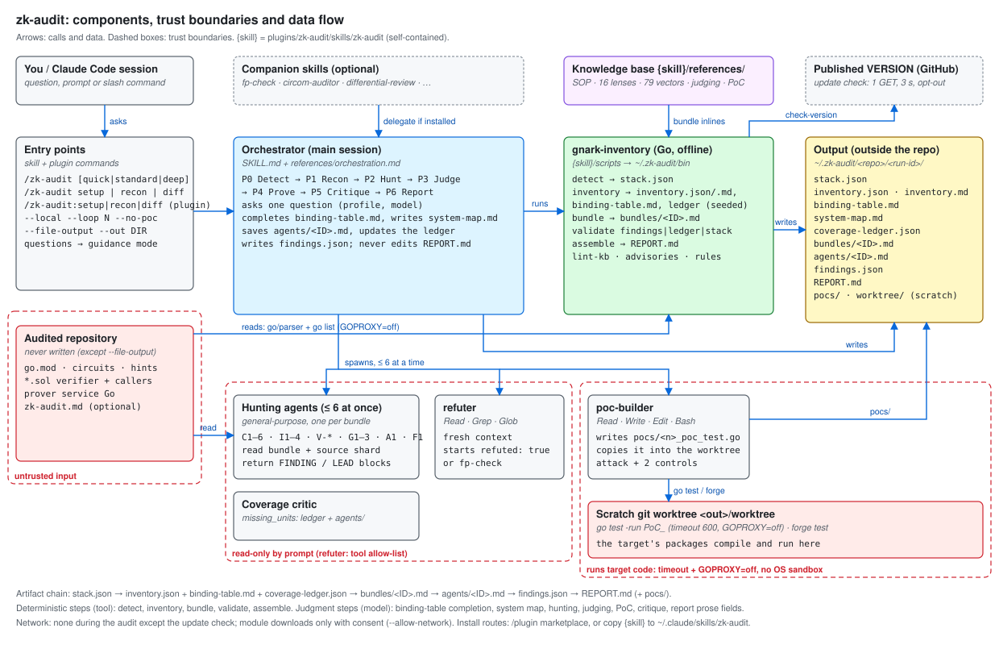

# X-Ray Report

> zk-audit | 7,081 Go lines (tool, non-test) + 3,499 lines of prompts and knowledge base | `4d9cf86` (`docs/x-ray`, stacked on `feat/pashov-parity`) | Claude Code plugin + standalone skill, Go 1.24 | 28/10/26

This is an x-ray of zk-audit itself, in the format of
[pashov/skills `x-ray`](https://github.com/pashov/skills/tree/main/x-ray),
adapted from a Solidity protocol to an agent-plus-tool project: "contracts"
are components, "entry points" are commands, skill modes and CLI subcommands,
and "invariants" are the system's own rules and where (or whether) code
enforces them. Companion files: [entry-points.md](entry-points.md),
[calls.md](calls.md), [invariants.md](invariants.md),
[architecture.svg](architecture.svg) (source: `architecture.json`,
`gen_architecture.py`).

`{skill}` = `plugins/zk-audit/skills/zk-audit/`; `<out>` = `~/.zk-audit/<repo>/<run-id>/`.

---

## 1. Overview

**What it does:** a Claude Code skill that audits gnark (Go) ZK circuits and
the Solidity verifier, protocol state and prover service that consume their
proofs, by running a deterministic Go inventory tool, fanning bounded hunting
agents over per-agent bundles, judging, proving with Go / Foundry PoCs, and
rendering a report from schema-validated JSON.

- **Users:** circuit authors and auditors running Claude Code on a gnark repository.
- **Core flow:** `/zk-audit` → Detect → Recon → Hunt → Judge → Prove → Critique → Report.
- **Key mechanism:** judgment by the model, bookkeeping by code: the tool writes the inventory, the ledger seed and the bundles, validates every JSON hand-off, and renders `REPORT.md`; the model fills in what code cannot decide.
- **Install model:** a Claude Code plugin (marketplace `zk-audit`) or the skill folder copied alone into `~/.claude/skills/zk-audit` ([pashov-parity.md](../pashov-parity.md)).
- **Control model:** the user's session permissions; there is no server, no account and no secret. One outbound request by default (update check).



### Components in scope

| Subsystem | Key files | Size | Role |
|---|---|---:|---|
| Skill entry | `{skill}/SKILL.md`, `references/orchestration.md`, `references/modes/*.md` | 327 + 211 + 96 lines | Mode selection, hard rules, phases, turn-by-turn orchestration, setup / recon / diff |
| Knowledge base | `references/agents/` (16 lens files), `references/attack-vectors/` (12 slices, 79 vectors), `judging.md`, `shared-rules.md`, `senior-auditor-sop.md`, `poc-templates.md`, `gnark-versions.md`, `gnark-api-footguns.md`, `rationalizations.md`, `report-format.md`, `companions.md` | 3,499 lines (42 files, including orchestration and modes) | What agents read; inlined into bundles by the tool |
| Agent briefs | `{skill}/agents/{poc-builder,refuter}.md` (canonical), `plugins/zk-audit/agents/` (plugin copies) | 110 lines | PoC writer/runner; fresh-context refuter |
| Plugin shell | `.claude-plugin/marketplace.json`, `plugins/zk-audit/.claude-plugin/plugin.json`, `plugins/zk-audit/commands/*.md` | — | Marketplace, manifest, three thin commands |
| Inventory tool | `{skill}/tools/gnark-inventory` (15 packages, vendored `x/tools`) | 7,081 Go lines | detect, inventory, bundle, validate, assemble, lint-kb, advisories, rules |
| Wrappers | `{skill}/scripts/{gnark-inventory,validate-findings,validate-ledger,assemble,check-version}` | 5 scripts | Build-once wrapper, aliases, update check |
| Schemas | `{skill}/schemas/{findings,ledger,stack}.schema.json` (+ embedded copies) | 3 | Contracts between phases |
| Evals | `plugins/zk-audit/evals/` (sanitizer, run-pocs, pool answer key, PoCs, baseline) | 1 fixture | Blind-run scoring and executed PoCs |
| Dev / CI | `Makefile`, `.github/workflows/ci.yml`, `test/standalone-skill.sh`, `test/parity/` | — | Offline checks, typed fixtures, eval PoCs, install checks |

### How it fits together

The core trick: every hand-off between model steps is a file the tool can
check (`stack.json`, `inventory.json`, `coverage-ledger.json`,
`findings.json`), and the only artifact a reader sees (`REPORT.md`) is
rendered by code from those files.

#### Full audit

```text
/zk-audit [profile]                                    SKILL.md §1-§4
├─ P0 scripts/gnark-inventory detect → <out>/stack.json       (+ check-version, companion detection)
├─ P1 scripts/gnark-inventory inventory → inventory.{json,md}, binding-table.md, coverage-ledger.json (planned)
│     model completes binding-table.md, writes system-map.md   ◄ facts only, `?` when unknown
│     scripts/gnark-inventory validate ledger
├─ P2 scripts/gnark-inventory bundle --profile P → bundles/<ID>.md
│     hunting agents (≤ 6) read bundle + shard → FINDING/LEAD text → <out>/agents/<ID>.md
│     model updates ledger units: covered | candidate | blocked
├─ P3 judging.md: dedup, 4 gates, severity × confidence → findings.json (draft)
├─ P4 git worktree add <out>/worktree → poc-builder → pocs/ → go test / forge   ◄ target code executes
│     refuter (fp-check | zk-audit:refuter | brief) → evidence, confidence
├─ P5 coverage critic → missing_units → targeted wave (standard, deep)
└─ P6 validate findings + ledger → assemble → REPORT.md      ◄ refuses invalid input, no clean claims
```

#### Recon and diff

```text
/zk-audit recon   → P0 + P1 → prints stack, circuits, binding table, hints, footguns, 5-10 questions
/zk-audit diff B  → worktrees <out>/base, <out>/head → inventory ×2 → compare (removed Assert*, reordered
                    public inputs, new hints, gnark bumps, regenerated Verifier.sol) → standard profile
```

#### Report assembly

```text
assemble --out <out> --repo <repo>
├─ validate.Document(findings | ledger | stack)   any error → exit 1, no file
├─ checkClaims                                   banned clean-claim phrases → exit 1
├─ crossCheck                                    run_id, unknown fingerprints, open units, lines past EOF → warnings
└─ render                                        quotes from <repo> (no abs, no ..), coverage from ledger only
```

---

## 2. Threat & Trust Model

### Profile

> Classified as: **LLM agent orchestrator** with **untrusted-code analysis** and **code execution (PoC)** characteristics.

The audited repository is attacker-influenceable input that the system both
reads into model context and, in Phase 4, compiles and runs.

### Actors & adversary model

| Actor | Trust level | Capabilities |
|---|---|---|
| User | Trusted | Chooses profile, approves installs, network and permission prompts |
| Orchestrator (main session) | Bounded (by the session's permissions) | All session tools; writes `<out>`; spawns agents; runs scripts |
| Hunting agents, coverage critic | Bounded (read-only by prompt only) | General-purpose agents: same tools as the session (P-1) |
| `zk-audit:refuter` (plugin) | Bounded (tool allow-list) | `Read Grep Glob` only; general-purpose in a standalone install |
| `zk-audit:poc-builder` | Bounded (prompt) | `Read Grep Glob Write Edit Bash`; runs `go test` / `forge test` |
| Audited repository | Untrusted | Source text, comments, `go.mod`, `foundry.toml`, package `init` code, symlinks |
| Companion skills | Bounded (third-party prompts) | Run inside the same session when installed |
| Published `VERSION` file | Untrusted (display only) | Its content is printed only if it parses as a dotted number |

**Adversary ranking**

1. **Repository author** — the code under audit can steer every agent that reads it and runs code in Phase 4.
2. **Imperfect model** — skips or misreports steps whose rules are prompt-only (invariants P-1 … P-18).
3. **Companion skill author** — a delegated skill's output becomes `findings.json` records.

### Trust boundaries

- **Audited repo → model context** — every agent reads target text; the binding table the orchestrator completes from that text is inlined into every bundle (`bundle.go` `render`); no isolation beyond prompt rules (P-1, P-8).
- **Audited repo → tool** — `inventory` runs `go list` in the target via `go/packages` with `NeedCompiledGoFiles` (`internal/load/load.go:192`), so cgo preprocessing can run on cgo packages; `GOPROXY=off` (G-14) is the only environment change.
- **Audited repo → execution (P4)** — PoCs compile the target package in `<out>/worktree` and run `go test` (package `init`, any `TestMain` in that package) or `forge test`; the guard is `timeout 600` and `GOPROXY=off`, not an OS sandbox (P-3).
- **Agents → target files** — read-only is an instruction for hunters and the critic; only the plugin refuter has a tool allow-list (P-1).
- **Tool → filesystem** — writes only to `--out` / `--report`; inside-repo paths are warned about, not refused (G-16).
- **Session → network** — the update check (one GET, G-19) and consented `--allow-network` / `go mod download`; agents are not network-restricted (P-7).
- **Output location** — `<out>` under `~/.zk-audit`, outside the repo; repo writes only with `--file-output` or the recon `zk-audit.md` on yes (`SKILL.md` §3 rule 1).

### Key attack surfaces

- **PoC execution of target code** &nbsp;&#91;[P-3](invariants.md#p-3), [P-4](invariants.md#p-4)&#93; — `agents/poc-builder.md` step 5 runs `go test ./<pkg>/` in the circuit's own package; trace what else that compiles and runs (package `init`, `TestMain`, cgo) and whether `-mod=mod` can reach beyond the module cache.

- **Target text steering general-purpose agents** &nbsp;&#91;[P-1](invariants.md#p-1), [P-8](invariants.md#p-8)&#93; — hunters run with the session's full tool set; check what a comment or string in the target can make an agent do, and whether a read-only plugin agent type for hunters is feasible.

- **`go list` on the target during recon** &nbsp;&#91;[G-14](invariants.md#g-14)&#93; — `load.go:189-246` inherits `CGO_ENABLED`, `GOWORK` and other `GOFLAGS`; trace which target files (`go.work`, `#cgo` directives, `toolchain`) influence the go command.

- **Model-written coverage ledger** &nbsp;&#91;[G-8](invariants.md#g-8), [G-11](invariants.md#g-11), [P-12](invariants.md#p-12)&#93; — `covered` needs only non-empty `agent_ids` and `reviewed_paths`; trace whether the report's "examined" count can exceed what `<out>/agents/` shows.

- **Self-reported PoC results** &nbsp;&#91;[G-3](invariants.md#g-3)&#93; — `evidence: POC` trusts `poc.result: demonstrated`; nothing checks `poc.path` or re-runs it.

- **Report quoting through symlinks** &nbsp;&#91;[G-13](invariants.md#g-13)&#93; — `render.go:453-457` refuses `..` and absolute paths but follows a symlink inside the repo.

- **Eval answer keys shipped with installs** &nbsp;&#91;[P-14](invariants.md#p-14)&#93; — the plugin cache holds `evals/` and `testdata/`; check what a blind eval run can reach under `${CLAUDE_PLUGIN_ROOT}` and `{skill}/tools/gnark-inventory/testdata`.

---

## 3. Entry points

> Full map: **[entry-points.md](entry-points.md)** — 6 skill modes, 3 plugin
> commands, 4 agent roles, 10 CLI subcommands with every flag, 5 scripts and
> 8 developer entry points, each with what it reads and writes.

Skill flags (`--local`, `--loop N`, `--no-poc`, `--file-output`, `--out`) are
parsed by the model, not by code. CLI flags are Go `flag` sets in `main.go`;
`TestDocumentedCommandsExist` fails if a doc names one that does not exist.

---

## 4. End-to-end flow per phase

| Phase | Runs (file / agent / subcommand) | Reads | Writes | Gate |
|---|---|---|---|---|
| 0 Detect | orchestrator; `scripts/gnark-inventory detect`; `scripts/check-version`; companion detection (`companions.md`) | `<repo>` go.mod, imports, `.sol`, configs | `<out>/stack.json` | none; routes `.circom` / Noir / no-fit |
| 1 Recon | `scripts/gnark-inventory inventory`; orchestrator reads `inventory.md` and every `Define`; `validate ledger` | `<repo>`, `zk-audit.md` | `inventory.json`, `inventory.md`, `binding-table.md` (draft → completed), `system-map.md`, `coverage-ledger.json` | ledger validator (G-1, G-7, G-8) |
| 2 Hunt | `scripts/gnark-inventory bundle --skill {skill} --profile P`; hunting agents per bundle | bundles, shard sources, module-cache gnark | `bundles/<ID>.md`, `bundles/index.json`, `agents/<ID>.md`, ledger statuses | `bundle` fails on zero bundles |
| 3 Judge | orchestrator with `judging.md`, `rationalizations.md` | `agents/*.md` | `findings.json` (draft) | prompt (dedup, 4 gates) |
| 4 Prove | `git worktree add`; `zk-audit:poc-builder` (or brief); `fp-check` / `zk-audit:refuter` (or brief) | findings, `poc-templates.md`, worktree | `pocs/`, `worktree/`, record `evidence` / `poc` / `refuter` | prompt (P-3, P-4); G-3 on the label |
| 5 Critique | coverage critic (inline prompt); targeted wave | ledger, `inventory.md`, `binding-table.md`, `agents/` | `missing_units`; ledger `deferred` + reason | prompt |
| 6 Report | `validate findings`, `validate ledger`, `scripts/gnark-inventory assemble` | `findings.json`, `coverage-ledger.json`, `stack.json`, `inventory.json`, `<repo>` | `REPORT.md`; `--file-output` copy in the repo | G-9, G-10, G-11 |

Profiles select agents (`bundle.go:39-68`): **quick** C1, I1, G2, 12 V-shards
(1 pass, PoCs for confirmed Critical/High); **standard** adds C2–C6, I2–I4,
F1 (critic + one wave); **deep** adds G1, G3, A1, 3 passes with memory.

### Concurrency

- At most six hunting agents at a time (and at most six refuters), with an `Agent Progress` table (`orchestration.md` Turn 4, Turn 6); prompt-only (P-5).
- The phase table and the agent table share status words (`Pending → Running → Done | Skipped | Blocked`), one phase `Running` (`SKILL.md` §4).
- `scripts/gnark-inventory` builds to a temp file and `mv`s it (`scripts/gnark-inventory:20-22`), so parallel first calls do not see a half-written binary.
- Inside the tool only `go/packages` runs in parallel (`errgroup`, vendored `x/tools`); everything else is single-threaded and sorted for determinism (`fsutil.Walk` sorts by path).
- Loop mode reruns Turns 3–7 sequentially per pass (`orchestration.md` "Loop mode").

---

## 5. Integrations

### Companion skills

Detection: the runtime's skill list first; fallback `find -L … -maxdepth 8` over
`~/.claude/skills`, `.claude/skills`, `~/.claude/plugins`, `~/.agents/skills`,
`~/.codex/skills` (`references/companions.md`). Installs are shown and run only
on a yes (`modes/setup.md`).

| Companion | Source | When called | Fallback | Wired to a turn |
|---|---|---|---|---|
| `circom-auditor` | zkSecurity | P0, `.circom` in scope | `generic-zk.md` vectors | yes (Phase 0) |
| `fp-check` | Trail of Bits | P4 refuter | `zk-audit:refuter` / brief | yes (Turn 6) |
| `spec-to-code-compliance` | Trail of Bits | C6 lens | C6 | yes (lens file) |
| `supply-chain-risk-auditor` | Trail of Bits | I4 lens | `gnark-versions.md` | yes (lens file) |
| `differential-review` | Trail of Bits | diff mode | standard profile on the change | yes (`modes/diff.md`) |
| `solidity-auditor`, `x-ray` | pashov | Solidity beyond the ZK surface; threat model | S1 + V-contract (standard, deep); I1–I3 in quick | `solidity-auditor`: orchestration Turn 4 on the scratch worktree, `convert pashov`; `x-ray`: none |
| `audit-context-building`, `vulnerability-triage-brocards`, `variant-analysis`, `static-analysis`, `building-secure-contracts`, `property-based-testing`, `mutation-testing` | Trail of Bits | deep context, triage, variants, Semgrep/CodeQL, Slither, oracle tests | recon, `rationalizations.md`, grep `inventory.json`, skip and note | no call site |
| zkao CLI | zkSecurity (paid) | deep profile, suggestion only | — | no |

Delegated results become `findings.json` records with `detected_by:
<companion>` by instruction; there is no converter. The report's companion line
comes from the model-filled `findings.json` `companions` field.

### External tools

| Tool | Used by | When | Without it |
|---|---|---|---|
| `go` ≥ 1.24 | wrapper build; `go/packages` (`go list`) in `inventory`; PoCs (`go test`); `make` | P0, P1, P4 | no inventory, no PoCs (`companions.md` Tools) |
| `git` | worktrees for PoCs and diff | P4, diff | PoCs disabled |
| `forge` | contract PoCs (`T-FOUNDRY-*`) | P4 | contract findings stay `ANALYSIS` |
| `semgrep`, `slither` | only through `static-analysis` / `building-secure-contracts` companions | — | skipped, noted under coverage |
| `curl`, `bash` | `check-version`, all wrappers | Turn 1, setup | update check silently skipped |

---

## 6. Invariants

> ### Full invariant map: **[invariants.md](invariants.md)**
>
> - **20 runtime guards** (`G-1` … `G-20`) — checks in the tool that refuse or warn
> - **13 test-enforced rules** (`T-1` … `T-13`) — schema / advisory / agent / version sync, docs lint, KB lint, fixtures
> - **18 prompt-only rules** (`P-1` … `P-18`) — read-only agents, PoC sandbox, concurrency, no installs, dedup, answer-key isolation
>
> The `Partial` and `No` blocks are where the design relies on the model.

---

## 7. Documentation quality

| Aspect | Status | Notes |
|---|---|---|
| README | Present | Scope, properties, install (both routes), use, status. Status drift fixed on this branch (assembler and eval baseline were listed as missing). |
| Design | `PLAN.md`, `docs/design-notes.md`, `docs/research.md` | Deviations from the plan are recorded; PLAN now points to them. |
| Per-component | `plugins/zk-audit/README.md` (every subcommand; `assemble` row added here), Go package comments | — |
| Attribution | `NOTICE` + per-file headers for adapted MIT text | Trail of Bits text is not copied |
| Docs-vs-code checks | T-5 … T-10 | A doc naming a missing script, flag, reference or path fails `go test` |

Drift found and fixed on this branch: README status table (assembler "not
built", "no end-to-end run", eval "not started"); plugin README missing
`assemble`; skill description missing `/zk-audit setup`; hard rule 1 omitting
the recon `zk-audit.md` write; PLAN not pointing at the deviations.

Repository name: manifests, README, Go module path and the update-check URL
use `shramee/zk-audit`, which is the public repository; local clones made
before the rename still point at `shramee/circuits-audit`, which GitHub
redirects. Both install routes were run from GitHub
([pashov-parity.md](../pashov-parity.md) (e)).

---

## 8. Test, CI and eval surface

| Metric | Value | Source |
|---|---|---|
| Go test functions | 47 in 14 test files | file scan |
| Go test lines | 1,703 | file scan |
| Golden files | 2 (`internal/assemble/testdata/{full,empty}`) | `TestGoldenFull`, `TestGoldenEmpty` |
| Fixtures | `testdata/pool` (3 circuits, 2 contracts), `testdata/edge` | typed tests need `make fixtures` |
| Coverage % | not measured | no `-cover` in CI |

| Category | Count / where | Notes |
|---|---|---|
| Unit | 13 of 15 packages have tests; `fsutil` and `report` are covered through callers | `go test ./...` |
| Docs / KB lint | 6 docs tests + `lint-kb` | T-5 … T-10 |
| Typed integration | `make test-types` (gnark v0.14.0 fixtures) | CI step 2, network |
| Executed PoCs | `make eval-pocs`: 4 PoC tests + 1 decoy on a sanitized copy | CI step 3, network |
| Install smoke | `make standalone` (skill folder alone) | CI step 1 |
| Model evals | 1 recorded blind run: pool, quick, `--no-poc`, 9.3 min, about 10.7 USD, recall 12/14, 0 false positives (`evals/baseline/pool-quick.md`) | manual, not in CI |
| Fuzz / property | none | — |

CI (`.github/workflows/ci.yml`): Ubuntu, Go 1.24, three steps — offline
`make check`, `make test-types`, `make eval-pocs`; `permissions: contents:
read`.

### Gaps

- No scored model eval in CI; one fixture, no all-safe panel, no negative-trigger cases, no `case.yaml` suite (PLAN §8).
- No `gofmt` check: `internal/assemble/render.go` and `assemble_test.go` are not gofmt-clean on `origin/main`.
- No `claude plugin validate` in CI (it passes today; [pashov-parity.md](../pashov-parity.md)).
- No test that profile definitions agree across `SKILL.md`, `orchestration.md`, README and `bundle.Agents` (P-17).
- `fsutil` and `report` have no direct tests; the jsonschema package is a hand-written subset of draft 2020-12 with one test file.

---

## 9. Developer & git history

> Repo shape: normal development, 43 commits on `origin/main` over five days
> (2026-10-25 → 2026-10-29), merged through 2 pull requests (#4, #5).

| Signal | Value | Assessment |
|---|---|---|
| Contributors | 1 author (`shramee`), model co-authored commits | single maintainer |
| Merge commits | 2 of 43 | PR flow exists; no second reviewer visible |
| Conventional commits | 40 of 41 non-merge subjects typed (16 `feat`, 9 `docs`, 6 `test`, 5 `fix`, 2 `chore`, 2 `ci`; the first is `init`) | consistent |
| Fix commits on main | 5 (`fix(gnark-inventory)` ×3, `fix(skill)` ×2) | two follow the first blind eval run |
| Hotspots | `SKILL.md` (6), `main.go` (5), `orchestration.md` (4), `inventory.go`, `report-format.md`, `poc-templates.md`, eval PoCs (3 each) | the prompt files churn most |

- **Eval-driven fixes** — `15e8c19` and `d8694a0` landed minutes before the baseline record `3345ee1` (fixture names in examples; inventory friction from the first blind run).
- **Prompt files are the hotspot** — 3 of the top 6 changed files are prompts, which have no executable tests beyond docs lint.

---

## Worth investigating

Design weak spots, in priority order. Investigation pointers, not findings.

1. **PoC runs execute target code without an OS sandbox** — `timeout` and `GOPROXY=off` are the only limits; consider a container / `bwrap` / `sandbox-exec` wrapper, `CGO_ENABLED=0`, and a network namespace for P4 ([P-3](invariants.md#p-3)).
2. **Hunters are general-purpose agents** — "read-only" holds by prompt; a plugin agent type with `tools: Read, Grep, Glob` would make it structural in plugin installs; standalone installs cannot restrict tools ([P-1](invariants.md#p-1)).
3. **`go list` on untrusted repos** — `targetEnv` keeps `CGO_ENABLED`, `GOWORK`, other `GOFLAGS`; consider `CGO_ENABLED=0`, `GOWORK=off`, `GOTOOLCHAIN=local`, `GOFLAGS=` for loading ([G-14](invariants.md#g-14)).
4. **Ledger truthfulness is unchecked** — `assemble` could warn when a `covered` unit's agents have no `<out>/agents/<ID>.md` or its `reviewed_paths` fall outside the unit's paths ([G-8](invariants.md#g-8)).
5. **PoC evidence is self-reported** — `validate` could require `poc.path` to exist under `<out>/pocs/` for `evidence: POC` ([G-3](invariants.md#g-3)).
6. **Answer keys ship in installs** — move `evals/` and the tool's `testdata/` outside `plugins/zk-audit/` so neither the plugin cache nor a copied skill folder carries them ([P-14](invariants.md#p-14)).
7. **Profiles are defined four times** — add a test that parses the `SKILL.md` profile table against `bundle.Agents` ([P-17](invariants.md#p-17)).
8. **Inside-repo writes only warn** — `inventory --out` and `assemble --report` inside the target could be refused unless `--file-output` semantics apply ([G-16](invariants.md#g-16)).
9. **Symlinked quotes** — resolve with `filepath.EvalSymlinks` and recheck the prefix before quoting ([G-13](invariants.md#g-13)).
10. **Update check is default-on** — the one network call in an otherwise offline design; the URL returns 404 until `VERSION` reaches `main`, and the check is silent until then ([G-19](invariants.md#g-19)).
11. **Binary cache keyed by version + mtime** — two checkouts at the same `Version` share `~/.zk-audit/bin/gnark-inventory-<ver>`; a content hash would remove the mtime dependence (`scripts/gnark-inventory:9-13`).
12. **Prompt-only features** — `--loop` memory, diff triggers, critic waves and companion delegation have no tool support; their behaviour is untested ([P-18](invariants.md#p-18)).

---

## X-Ray Verdict

**FRAGILE** — the deterministic half is well tested and fails closed, but the safety rules that matter most for running on untrusted code (read-only agents, PoC isolation, no network) are prompt-only.

| Axis | Tier | Basis |
|---|---|---|
| Tests | ADEQUATE (tool) / FRAGILE (agent behaviour) | Unit + golden + docs/KB lint + typed fixtures + executed eval PoCs + install smoke in CI; one manual model eval, none in CI, no fuzzing |
| Docs | ADEQUATE | README, PLAN, design notes, NOTICE, docs-vs-code tests; status drift existed until this branch |
| Robustness | FRAGILE | Validators and assembler refuse bad input; 18 prompt-only rules, including all isolation of untrusted code |

**Structural facts:**
1. 7,081 Go lines in 15 packages with one external module family (`golang.org/x/tools`, vendored); 47 Go tests.
2. 3,499 lines of prompts and knowledge base: 16 lenses, 79 sourced vectors in 12 slices, 23 footgun detector rules, 11 embedded advisories.
3. 20 runtime guards and 13 test-enforced rules versus 18 prompt-only rules (invariants.md).
4. One recorded blind end-to-end run: quick profile, 17 subagents, recall 12/14 on the pool fixture.
5. Single maintainer, 43 commits in five days, 2 merged pull requests.
